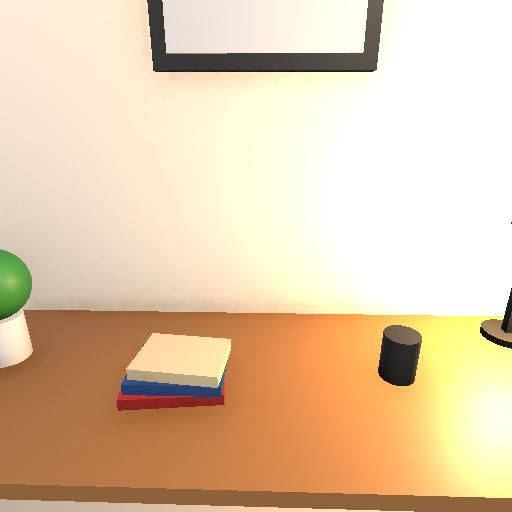
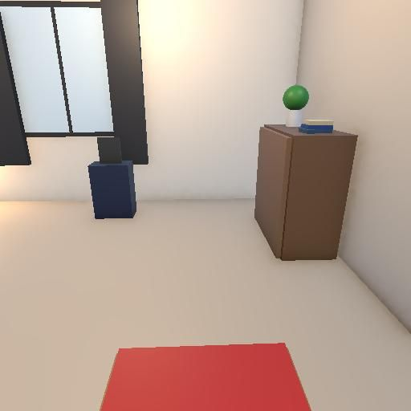
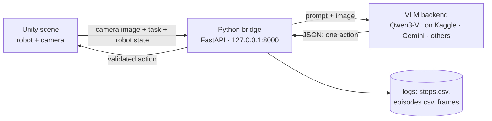

# HabitatVLM

**A robot in a Unity space habitat that is driven by a vision-language model (VLM).**
The robot's camera image and a task in plain English go to the VLM; the VLM answers with one
action at a time (`move_to`, `pick`, `place`, `open`, `close`, `look_around`, `done`); Unity carries it out.

> Course project — **DA-232o Intelligent User Interface**, Indian Institute of Science (IISc), August 2026 term.
> Instructor: pradipta@iisc.ac.in

| Room 05 — study corner (robot camera) | Room 06 — bedroom (robot camera) |
|---|---|
|  |  |

---

## 1. The idea

**"The VLM decides *what*, Unity decides *how*."**

Large vision-language models can look at a picture and reason about a task, but they are poor at
precise motor control. Game engines are the opposite. HabitatVLM splits the job:

- **The VLM (the "brain")** sees the robot's camera image, the task, the robot's state and the
  history of its own actions, and picks **one high-level action** per step,
  e.g. `pick(red_canister)` or `place(red_canister, cabinet_left)`.
- **Unity (the "body")** checks the action and performs it with real navigation (NavMesh), arm
  reach checks, hinged doors and lids, and physics. It reports back *"OK — holding red_canister"* or
  *"FAIL — cabinet_left is closed; open it first"*, which the VLM sees on the next step.
- **A small Python bridge** sits between them. It builds the prompt, calls the model, validates the
  JSON reply, retries or falls back to a safe action, and logs every step with the camera frame.



The same code works in **any room**: every object describes itself (item, surface, container or
location), so new rooms are built from small JSON layout files without changing the code.

## 2. Features

- **Four ways to control the robot** (sidebar panel; each mode accepts only its own input):
  - **Tasks** — pick a prepared task, or run the whole evaluation suite.
  - **Text** — type any command, e.g. *"put the blue canister on the table"*.
  - **Click** — click the floor to walk there, or click an object to walk to it (no VLM).
  - **Point + Say** — click an object ("this") and a spot ("there"), then type *"move this to there"*.
- **6 rooms**: the original habitat module plus a storage bay, science lab, galley, study corner and
  bedroom. The last two are modelled on reference photos.
- **Swappable model backends**: Qwen3-VL on a free Kaggle GPU, Google Gemini, or any
  OpenAI-compatible service. You change one setting.
- **Safety net**: replies are validated (names, object kinds, required fields), and an invalid reply is
  re-asked once and then replaced by a harmless `look_around`. Impossible requests end with *"CANNOT: …"*.
- **Evaluation tools**: 69 tasks with automatic success checks, `eval/analyze.py` (tables and charts),
  `eval/show_episode.py` (step-by-step replay of what the model said and did).

## 3. Repository layout

```
├── Unity (VLM Project)/        Unity 6 project
│   ├── Assets/Scenes/           SampleScene.unity (room 01) and Rooms/room_02 … room_06.unity
│   ├── Assets/Scripts/          Robot/ (skills, interactables), Agent/ (agent loop, panel, modes), Editor/ (room builder)
│   ├── Assets/Rooms/            room_0X.json — room layouts
│   └── Assets/Tasks/            tasks_room0X.json — task suites with success conditions
├── bridge/                      Python bridge (FastAPI)
│   ├── main.py  vlm.py  prompts.py  validator.py  logger.py  settings.py
│   ├── config.yaml              backend settings (no secrets)
│   ├── .env.example             template for keys and the Kaggle tunnel URL
│   └── tools/fake_unity.py      tests the bridge and model without Unity
├── kaggle/ollama_server.ipynb   runs Qwen3-VL on a Kaggle GPU and opens a tunnel
├── eval/                        analyze.py, show_episode.py, results.md, charts/
├── docs/images/                 pictures used in README.md and Report.md
├── requirements.txt             Python dependencies
├── SPEC.md  PLAN.md  Report.md
```

## 4. Requirements

| What | Version / note |
|---|---|
| Windows 10/11 | Tested on Windows 11 |
| [Git](https://git-scm.com/download/win) | any recent version |
| [Python](https://www.python.org/downloads/) | **3.11** (tick *"Add python.exe to PATH"* when installing) |
| [Unity Hub](https://unity.com/download) + **Unity 6000.6.7f1** | Install this exact editor version from Unity Hub (*Installs → Install Editor → Archive*). Required packages (URP, AI Navigation, Input System) download automatically. |
| A model backend | A **Kaggle** account (free GPU, phone-verified for internet access) **and/or** a **Google AI Studio** API key for Gemini |

Python packages (`requirements.txt`): `fastapi`, `uvicorn[standard]`, `pydantic`, `openai`
(the client for all OpenAI-compatible backends), `python-dotenv`, `pyyaml`, `pillow`, `requests`, `matplotlib`.
`requirements.lock.txt` holds the exact versions of a working install.

## 5. Installation (fresh Windows PC)

Open **PowerShell**.

```powershell
# 1. Get the code
git clone https://github.com/rituparnoc-web/da232o-assignment-2.git
cd da232o-assignment-2

# 2. Create the virtual environment "my_env" and install the bridge dependencies into it
py -3.11 -m venv my_env
my_env\Scripts\python.exe -m pip install --upgrade pip
my_env\Scripts\python.exe -m pip install -r requirements.txt

# 3. Create your private settings file (never commit it)
Copy-Item bridge\.env.example bridge\.env
notepad bridge\.env
```

Then open the Unity project:

1. **Unity Hub → Add → Add project from disk** and choose the `Unity (VLM Project)` folder.
2. Open it with **Unity 6000.6.7f1**. The first import takes a few minutes.
3. Open **`Assets/Scenes/SampleScene.unity`** (room 01).
   If `Assets/Scenes/Rooms/` is empty, run the menu **HabitatVLM → Build Rooms from Layouts** once.

## 6. Running with Qwen3-VL on Kaggle (free GPU)

The model `qwen3-vl:8b-instruct` runs in [Ollama](https://ollama.com) on Kaggle. A Cloudflare quick
tunnel makes it reachable from your PC.

**On Kaggle:**

1. Kaggle → **Create → New Notebook → File → Import Notebook** → upload `kaggle/ollama_server.ipynb`.
2. Right-hand panel → *Session options*: **Accelerator = GPU T4 x2** (or P100), **Internet = On**.
3. **Run All**. After about 3–5 minutes it prints a URL like `https://some-words.trycloudflare.com`
   and then *"Tunnel OK"*.

**On your PC:**

4. Put the URL in `bridge\.env`:
   ```
   KAGGLE_TUNNEL_URL=https://some-words.trycloudflare.com
   ```
5. Start the bridge. `kaggle` is the default backend in `bridge\config.yaml`:
   ```powershell
   cd bridge
   ..\my_env\Scripts\python.exe -m uvicorn main:app --port 8000
   ```
6. *(Optional)* In a second PowerShell, check it works without Unity:
   `cd bridge; ..\my_env\Scripts\python.exe tools\fake_unity.py`
7. In Unity press **Play**. The panel header should read `kaggle / qwen3-vl:8b-instruct · prompt v3.4`.

> **The tunnel URL changes every Kaggle session.** Update `bridge\.env` and restart the bridge each time.
> **Security:** the tunnel is public while the notebook runs. Don't share the URL, and use
> **Run → Stop session** when you are done (this also saves your ~30 h/week GPU quota).

## 7. Running with Google Gemini

1. Get a free API key at [Google AI Studio](https://aistudio.google.com/apikey) and put it in `bridge\.env`:
   ```
   GEMINI_API_KEY=your-key
   ```
2. Start the bridge with the Gemini backend. The setting lasts only for this PowerShell window:
   ```powershell
   cd bridge
   $env:VLM_BACKEND = "gemini"
   ..\my_env\Scripts\python.exe -m uvicorn main:app --port 8000
   ```
   To make it permanent, set `active_backend: gemini` in `bridge\config.yaml` instead.
3. In Unity press **Play**. The header should read `gemini / gemini-2.5-flash · prompt v3.4`.
4. To go back to Kaggle: `Remove-Item Env:VLM_BACKEND`, then restart the bridge.

The Gemini settings in `config.yaml` are `model: gemini-2.5-flash`, thinking switched off
(`reasoning_effort: "none"`), and a 7 s pause between calls.

> **Free-tier limit:** in our tests `gemini-2.5-flash` allowed only **20 requests per day** per project
> (about 3–4 tasks). When it runs out, the bridge stops with *"quota exhausted … daily request limit
> reached"*. It resets after midnight Pacific time. With billing enabled the limit is no longer a problem,
> and you can set `min_interval_s: 0`.

## 8. Other model backends

The bridge talks to every real backend through the **OpenAI-compatible chat API**, so any vision model
behind such an API can be used. Only `base_url`, `model` and the key change.
Add or edit an entry under `backends:` in `bridge/config.yaml` and select it with `VLM_BACKEND`:

```yaml
  local:                                   # Ollama on your own PC (needs a GPU with enough memory)
    type: openai
    base_url: "http://localhost:11434/v1"
    model: "qwen3-vl:4b-instruct"
    api_key_env: null

  groq:                                    # Groq cloud (put GROQ_API_KEY in .env)
    type: openai
    base_url: "https://api.groq.com/openai/v1"
    model: "meta-llama/llama-4-scout-17b-16e-instruct"
    api_key_env: "GROQ_API_KEY"

  myservice:                               # any other OpenAI-compatible provider, e.g. OpenRouter
    type: openai
    base_url: "https://openrouter.ai/api/v1"
    model: "<a vision model id>"
    api_key_env: "MYSERVICE_API_KEY"
```

There is also `mock`, a scripted backend with no model, for testing the Unity ↔ bridge connection.
Only **Kaggle (Qwen3-VL)** and **Gemini** were evaluated in this project. The others are supported by the
same code but untested.

## 9. Using the app

Press **Play** in Unity. The **sidebar** on the right shows the robot camera, the mode buttons, the status
and a log. Press **Tab** (or the **>** button) to hide it.

| Mode | How to use it |
|---|---|
| **Tasks** | Choose a task with **<** / **>** and press **Start**. Use the **Suite** row (all / easy / medium / hard / compare, repeats) and **Run all** to evaluate a room. **Reset room** restores the start layout. |
| **Text** | Type a command and press **Enter**, e.g. *"take the towel out of the laundry basket"*. ↑/↓ recalls earlier commands. |
| **Click** | Click the floor and the robot walks there. Click an object and it walks to it. |
| **Point + Say** | Click an object (**this**), then optionally a floor spot or another object (**there**). Type e.g. *"move this to there"* and send. The panel shows exactly what will be sent. |

**Named floor spots** the model understands: `home_base` (where the robot started; "base", "home") and
`marked_spot` (the last floor point you clicked in Point + Say).

**Rooms** — open a scene, then press Play:

| Scene | Room | Tasks |
|---|---|---|
| `Assets/Scenes/SampleScene.unity` | 01 Habitat module (shelf, table, two cabinets, canisters, toolbox) | 24 |
| `Assets/Scenes/Rooms/room_02.unity` | 02 Storage bay (racks, workbench, lockers) | 9 |
| `Assets/Scenes/Rooms/room_03.unity` | 03 Science lab (benches, sample fridge, tubes) | 9 |
| `Assets/Scenes/Rooms/room_04.unity` | 04 Galley (counter, dining table, pantry, fridge) | 9 |
| `Assets/Scenes/Rooms/room_05.unity` | 05 Study corner (desk, plant, books, laundry basket) | 9 |
| `Assets/Scenes/Rooms/room_06.unity` | 06 Bedroom (bed, pillows, dresser, storage tub with lid) | 9 |

**Make your own room:** copy a file in `Assets/Rooms/` (walls, colours, furniture, items, decor) and a
task file in `Assets/Tasks/`. Then run **HabitatVLM → Build Room from Layout…**. The builder creates the
scene, bakes navigation and adds it to the build settings.

## 10. Logs and evaluation

| Where | What |
|---|---|
| `bridge/logs/episodes.csv` | one row per task run: backend, model, prompt version, success, steps, time, reason |
| `bridge/logs/steps.csv` | one row per step: the model's action and thought, validity, latency, Unity's result |
| `bridge/logs/frames/<episode>/NNN.jpg` | the exact camera image the model saw at each step |
| Unity Console | `[Robot]` and `[Agent]` lines for every action |

```powershell
my_env\Scripts\python.exe eval\show_episode.py --list 20     # recent runs
my_env\Scripts\python.exe eval\show_episode.py --last 1      # what the model thought and did, step by step
my_env\Scripts\python.exe eval\analyze.py --latest           # writes eval/results.md and eval/charts/
my_env\Scripts\python.exe eval\analyze.py --compare --latest # only the backend-comparison task set
```

Results and the Qwen-vs-Gemini comparison are in **[Report.md](Report.md)**.

## 11. Troubleshooting

| Symptom | Fix |
|---|---|
| Panel says *Bridge not reachable. Is it running?* | The bridge isn't running, or it isn't on port 8000. Start it (section 6 or 7). |
| *model backend 'kaggle' unreachable* | The Kaggle session stopped, or the URL in `bridge\.env` is old. Re-run the notebook, update the URL and restart the bridge. |
| Header shows the wrong backend or prompt | A `VLM_BACKEND` variable is still set in that PowerShell window. Run `Remove-Item Env:VLM_BACKEND` and restart the bridge. |
| *quota exhausted* with Gemini | You've hit the free-tier daily limit. Wait for the reset, enable billing, or use Kaggle. |
| Robot walks through furniture, or room scenes are missing | Run **HabitatVLM → Build Rooms from Layouts** again. |
| Steps get very slow when Unity isn't focused | Keep the Unity window visible. The project sets *Run In Background*, but some laptops throttle hidden windows. |

## 12. Security notes

- API keys and the tunnel URL go **only** in `bridge/.env`, which is git-ignored. Never commit it.
- The Kaggle tunnel is public while the session runs. Stop the session after use.
- `bridge/logs/` (camera frames, model replies) is git-ignored.
