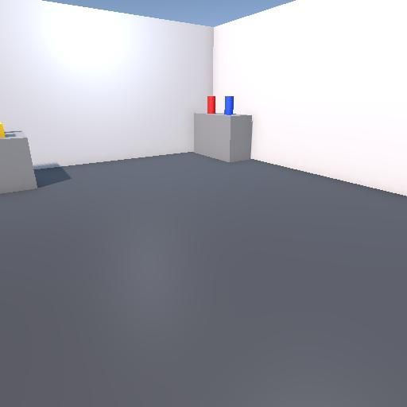
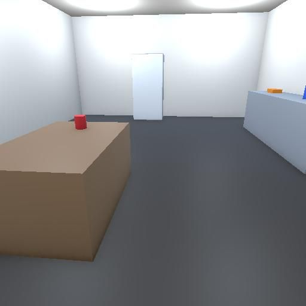
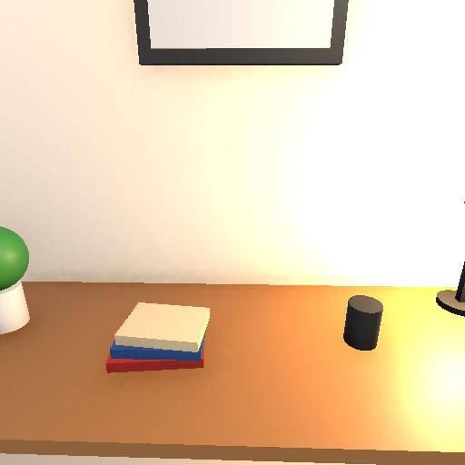
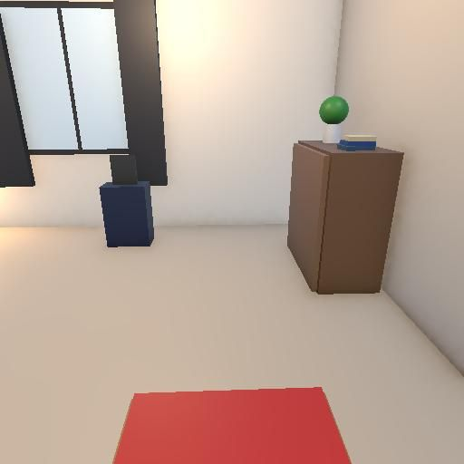
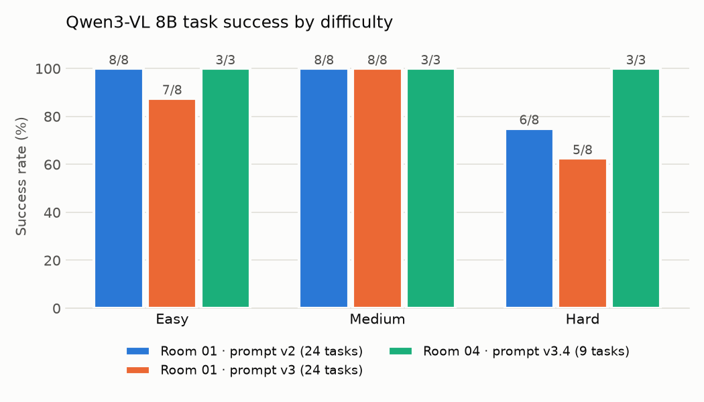
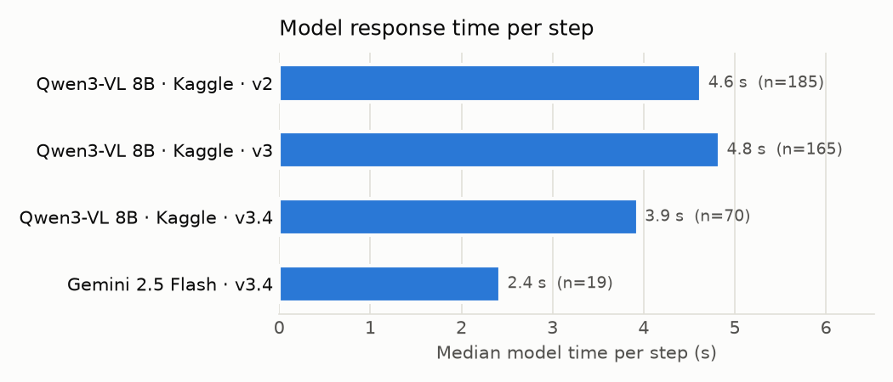

# HabitatVLM — Evaluation Report (summary)

> Course project — **DA-232o Intelligent User Interface**, Indian Institute of Science (IISc), August 2026 term.
> Instructor: pradipta@iisc.ac.in
> Data: all runs logged up to 12 Nov 2026 (`bridge/logs/`). Setup and usage are in [README.md](README.md).

## 1. Summary

- **Qwen3-VL 8B (open model, free Kaggle GPU) controls the robot reliably.** On the 24-task suite in
  room 01 it solved **22/24 (92 %)** with prompt v2 and 20/24 with v3. On the final prompt (v3.4) it
  solved **9/9** in the new galley room (room 04), including all hard multi-step tasks.
- **The approach carries over to new rooms without code changes.** Five extra rooms (two modelled on
  reference photos) were built from JSON layouts. Every task tried there succeeded (latest attempt per task).
- **The model almost never broke the action format:** 4 invalid replies in 576 model calls (0.7 %). The
  validator caught all 4.
- **Gemini 2.5 Flash** solved all **5/5** tasks it ran, in **fewer steps** and at **~2.4 s per step versus
  ~4.0 s** for Qwen. However, its **free tier allows only 20 requests per day**, so a full comparison
  needs the paid tier (estimated well under one US cent per step, section 5).

## 2. Evaluation setup

| Item | Setting |
|---|---|
| Robot actions | `move_to`, `pick`, `place`, `open`, `close`, `look_around`, `done`. One per step, at most **15 steps** per task |
| Model input per step | 512×512 robot-camera JPEG, the task, valid object names and kinds, robot state (holding, near, container states, where each item is), full action history, last result |
| Tasks | 69 tasks in 6 rooms, each **easy** (one action chain, e.g. open / pick up), **medium** (move one item) or **hard** (several items, or item + container state) |
| Success | Decided by **Unity from the final scene state** (e.g. "red_canister is inside cabinet_left and the cabinet is closed"), not by the model saying "done" |
| Models | `qwen3-vl:8b-instruct` via Ollama on a Kaggle T4 GPU; `gemini-2.5-flash` (thinking off) via Google's OpenAI-compatible API |

<table><tr>
<td> Room 01 — habitat module</td>
<td> Room 04 — galley</td>
<td> Room 05 — study corner</td>
<td> Room 06 — bedroom</td>
</tr></table>

*What the model actually sees: frames from `bridge/logs/frames/`.*

## 3. Results — Qwen3-VL 8B on Kaggle

| Run (latest attempt per task) | Tasks | Success | Easy | Medium | Hard | Avg steps (successes) | Median time / step |
|---|---|---|---|---|---|---|---|
| Room 01 · prompt v2 | 24 | **22/24 (92 %)** | 8/8 | 8/8 | 6/8 | 6.3 | 4.6 s |
| Room 01 · prompt v3 | 24 | 20/24 (83 %) | 7/8 | 8/8 | 5/8 | 5.9 | 4.8 s |
| Room 04 · prompt v3.4 | 9 | **9/9 (100 %)** | 3/3 | 3/3 | 3/3 | 6.3 | 4.0 s |
| Rooms 02, 03, 05, 06 (spot checks, v3.2–v3.4) | 5 | 5/5 | 5/5 | – | – | 3.8 | ~4.5 s |
| Free-form commands (Text, Point + Say) | 14 | 14 ended "done" | | | | | |

The free-form commands have no automatic success check. Review of their logs found one wrong
interpretation, which led to prompt v3.4 (see below).

**Where it failed.** Every failure was a **hard, multi-item** task:

| Failure type | Example |
|---|---|
| Said "done" too early | T08 *"Put the red and blue canisters in the right cabinet"*: placed one canister, then declared the task complete |
| Ran out of steps (15) | T21, T22, T23: wandered between objects or held an item without placing it |
| Wrong object from a colour description | T12 *"Open the purple cabinet"* (v3 only): the "match names exactly" rule made it reject the colour description |

Unity rejected 52 valid but impossible actions (e.g. *"table is out of reach"*, *"gripper is full"*).
The model usually corrected itself on the next step by reading the reason. A common waste: Qwen often
tries `pick` from across the room as its first action (8 times) and only then walks over.

**How the prompt evolved (each change fixed an observed failure):**

| Version | Change | Triggered by |
|---|---|---|
| v2 | Full action history, item locations, "is the task already complete?" check, repetition warning | Model kept working after finishing (undid its own work) |
| v3 | Split the task into parts, mark each done/not done; "holding + near destination → place now" | T08, T21 and T16 in the room-01 suite |
| v3.1 | Objects may be described by colour or position; resolve via the image | v3 broke T12 ("purple cabinet") |
| v3.2 | Named floor spots `home_base` / `marked_spot` | "Return to base" and Point-at-floor commands impossible |
| v3.3 | "Move X to Y" is complete only after X is **placed** | Point + Say ended holding the item |
| v3.4 | Furniture can't be carried; impossible task → `done` with "CANNOT:" (logged as not done) | "Move this basket" carried the book inside instead; "open the door" (decoration) reported success |

## 4. Generalisation to new rooms

The same scripts and prompt, with no room-specific rules, were used in five new rooms built from JSON
layouts: a storage bay, a science lab, a galley, and a **study corner** and **bedroom** modelled on
reference photos (desk, plant, books, laundry basket; bed, pillows, dresser, storage tub with a hinged
lid, wicker basket). Results: **room 04 9/9 full suite**, and every spot-checked task in rooms 02, 03,
05 and 06 succeeded (latest attempt; Qwen in all rooms, Gemini in rooms 04 and 05). The new rooms needed only engine-side additions (lids,
open-top baskets, decoration objects). The model side did not change.

## 5. Qwen vs Gemini

**Measured (same prompt v3.4):**

| | Qwen3-VL 8B · Kaggle | Gemini 2.5 Flash · free tier |
|---|---|---|
| Tasks run on v3.4 | 10 (room 04 full suite + S01) | 5 (G01, S01–S04) |
| Success | 10/10 (incl. 3 hard) | 5/5 (easy and medium only) |
| Same task, steps | G01: 3 · S01: 4 | G01: **2** · S01: **3** |
| Median model time per step | 3.9 s | **2.4 s** |
| Invalid replies | 0 | 0 |
| Wasted first-step `pick` from far away | common | not seen |
| Requests allowed | unlimited within ~30 GPU-hours/week | **20 per day** (`gemini-2.5-flash`), then HTTP 429 until reset |
| Setup per session | 3–5 min notebook start; tunnel URL changes each time | none (API key) |
| Cost | free | free (with the limit above) |
| Data | stays in your own Kaggle session; open weights | sent to Google (free-tier data may be used to improve Google's products) |

The free tier ended our Gemini run after about 20 requests, in the middle of task S05. The bridge now
detects this case and stops at once with a clear message.

**If Gemini is used as a paid service** (projection from the measurements above; check current
prices and limits before relying on them):

| | Qwen3-VL 8B · Kaggle | Gemini 2.5 Flash · paid |
|---|---|---|
| Daily limit | ~30 GPU-hours/week | effectively none for this workload (paid tiers allow hundreds+ requests per minute) |
| Pacing between calls | none | none needed (free tier needs ~7 s) |
| Model time for a typical 6-step task | ~24 s | **~14 s** |
| Tokens per step | – | ~1,000 text + ~260 image input, ~80 output |
| Cost per step | 0 | **≈ $0.0006** (at ~$0.30 per 1M input / ~$2.50 per 1M output tokens) |
| Room-01 suite (24 tasks, ~150 steps) | 0 | **≈ $0.09** |
| All 69 tasks (~430 steps) | 0 | **≈ $0.25** |
| Availability | only while a notebook runs | always on |

**Verdict.** Both models handle the task with the same prompt and the same validation. **Qwen3-VL on
Kaggle** is the better choice for development and repeated evaluation: it is free, unlimited in
practice, and keeps the data private. Its weakness is speed and the per-session setup. **Gemini 2.5
Flash** looked faster and slightly more efficient (fewer steps, no premature `pick`). On the paid tier it
would cost cents for a whole evaluation and be the better choice for a responsive, always-on
assistant. On the free tier it supports only a demo of 3–4 tasks per day. The Gemini sample is small
(5 tasks, 19 model calls, no hard tasks), so its success rate is not yet comparable to Qwen's.

## 6. Limitations

- One run per task. Results show capability, not statistical reliability (no repeats).
- The full suite on the final prompt (v3.4) covers room 04 only. Room 01 numbers are from v2/v3.
- The Gemini comparison is limited by the free-tier quota (section 5).
- The model receives the list of valid object names and their locations. Grounding is image +
  structured state, not image alone.
